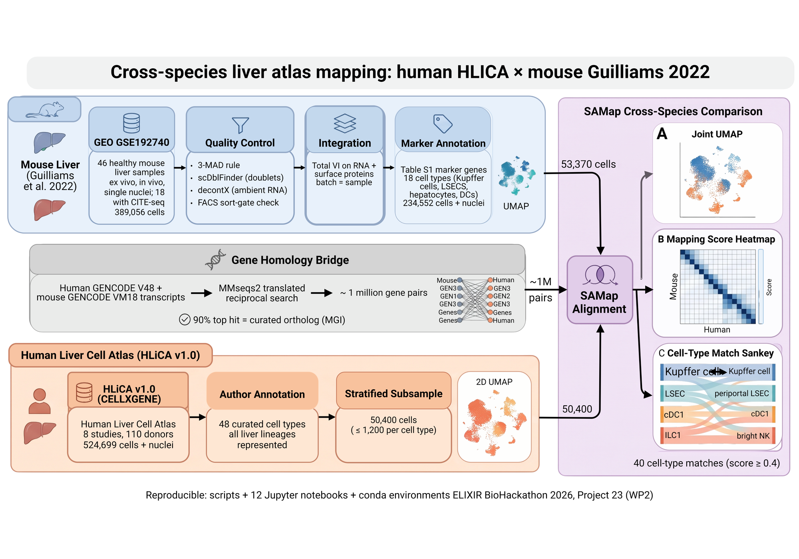
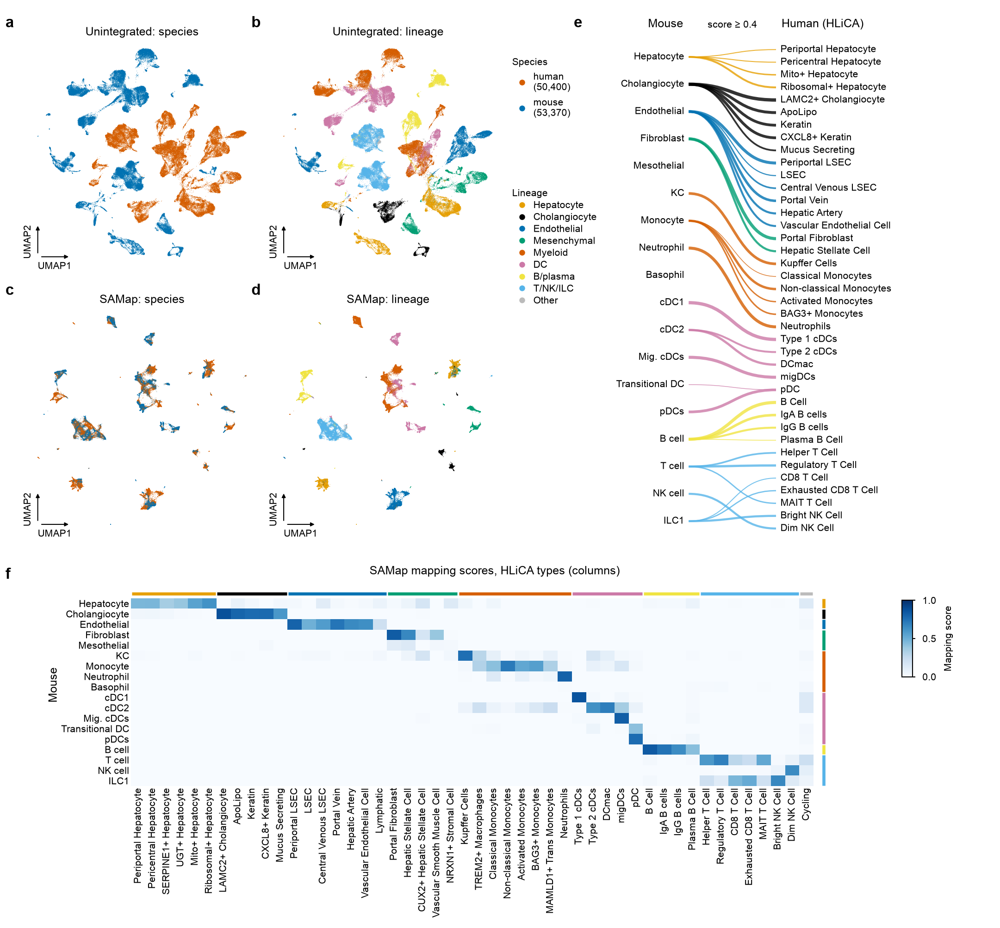

# Liver, human x mouse: SAMap between HLiCA and a rebuilt Guilliams et al. 2022 mouse atlas

WP2 contribution, ELIXIR BioHackathon 2026 Project 23 (George Gavriilidis, 11-13 Nov 2026). This is groundwork for
cross-species liver work.

**What is here**
- A rebuild of the healthy mouse liver atlas of Guilliams et al., Cell 2022 (Fig 1B). No processed mouse object or cell
  labels are public, so we rebuilt it from the GEO per-sample matrices and annotated it ourselves.
- Human–mouse gene maps for SAMap, built with the WP2 scripts on our liver gene sets.
- A SAMap run between that mouse atlas and the Human Liver Cell Atlas (HLiCA v1.0).
- Figures, a table and notebooks that recreate every step.



*Workflow overview (BioRender).*



## Results in brief

| | |
|---|---|
| Mouse atlas | 46 Fig 1B samples from GEO GSE192740 (15 ex vivo, 19 in vivo, 12 nuclei; 18 CITE-seq), 389,056 cells before QC → **234,552 cells + nuclei** after QC (paper: 185,894 after hand curation we cannot fully reproduce) |
| Mouse labels | 16 of the 17 Fig 1B types from the paper's Table S1 markers (no separate HsPC cluster), plus transitional DCs (735) and mesothelial cells (359). 6,859 cells (2.9 %) are left unresolved |
| Gene maps | MMseqs2, human GENCODE v48 × mouse GENCODE vM18, about 1 M pairs per direction. Against MGI curated 1:1 orthologs (15,137 protein-coding pairs), the ortholog is our top hit 90–91 % of the time and among the hits 97.6 % |
| SAMap | HLiCA 50,400 cells (at most 1,200 per author type) × mouse 53,370 (at most 4,000 per type). 40 matches with score ≥ 0.4 ([Table 1](results/figures/table1_samap_matches.pdf)) |

Selected SAMap scores: cholangiocyte 0.88, cDC1 0.86, B cell 0.84, fibroblast → portal fibroblast 0.83, migratory DCs
0.82, neutrophil 0.81, endothelial → periportal LSEC 0.80, pDC 0.77, KC → Kupffer cells 0.76.
- **ILC1 and NK cells** split as liver biology predicts: ILC1 → bright NK (0.66), NK → dim NK (0.65).
- **Basophils and mesothelial cells** have no HLiCA label and do not map.
- **Hepatocytes** map best to HLiCA's Ribosomal+ cluster (0.62), not to the zonated types. Our mouse hepatocytes are not
  split by zone.

**Caveat: shared lab.** HLiCA contains the human samples of Guilliams et al. 2022 (51,554 cells). The mouse atlas comes
from the same lab and study.

The [workflow schematic](results/figures/workflow_schematic.png) is a 2,000 px copy of the BioRender figure.

Figures (Nature format, 183 × 170 mm, PDF + PNG) are in [`results/figures/`](results/figures/):
- [Fig 1](results/figures/fig1_mouse_atlas.pdf): the mouse atlas.
- [Fig 2](results/figures/fig2_hlica.pdf): HLiCA, in the HLiCA authors' colours.
- [Fig 3](results/figures/fig3_samap.pdf): SAMap, with the unintegrated baseline first.
- [Table 1](results/figures/table1_samap_matches.pdf): the 40 matches with their top gene pairs (kableExtra).

## Code taken from the team, and how we handled it

| Team material (commit `85d99fba`) | What we did |
|---|---|
| `WP2/scripts/02_build_samap_fastas.py` | **Copied** to [`code/samap_maps/02_build_samap_fastas_liver.py`](code/samap_maps/). The diff against upstream is in [`02_vs_upstream.diff`](code/samap_maps/02_vs_upstream.diff). Changed: paths; species pair human + mouse, without zebrafish (species code `hu` → `hs`); the gene fields of our objects (HLiCA `feature_name`, Guilliams `symbol`); the GENCODE parser also accepts human `ENSG` IDs. **Unchanged:** gene naming (`Symbol` or `Symbol__EnsemblID`) and transcript choice |
| `WP2/scripts/03_build_mmseqs_maps.py` | **Copied** to [`code/samap_maps/03_build_mmseqs_maps_liver.py`](code/samap_maps/), diff in [`03_vs_upstream.diff`](code/samap_maps/03_vs_upstream.diff). Changed: paths, species pair, file names, `THREADS` 24 → 20 (shared VM). **All search parameters unchanged** (`-s 7.5 -e 1e-6 --min-length 30 --orf-start-mode 1 --max-seqs 10000 --max-accept 1000000 --max-rejected 1000000 -a`) |
| `WP2/scripts/01_download_transcriptomes.sh` | Not used. Our references differ: HLiCA is CELLxGENE schema 7.1 = GENCODE v48, and Guilliams used 10x `mm10-3.0.0` = GENCODE vM18 / Ensembl 93. The team used Ensembl 93 (human) and GENCODE vM12 (mouse) for muscle. Ours is [`01_download.sh`](code/samap_maps/01_download.sh) |
| `WP2/notebooks/SAMap_v3.0_Dre_Hsa_Mmu_annot2.ipynb` | **Recipe followed, rewritten as a script** ([`code/samap_run/02_samap.py`](code/samap_run/02_samap.py)): `SAMAP(filenames, f_maps)`, `sm.run()`, `get_mapping_scores(n_top=0)`, `GenePairFinder(...).find_all(align_thr=0.1)`, and the int64 index conversion before GenePairFinder. The input preparation ([`01_prep.py`](code/samap_run/01_prep.py)) follows its steps: counts in `X`, `var_names` = SAMap gene names |
| `WP1/SETUP.md` environment | **Followed**: Python 3.12, `hnswlib` from conda-forge, `sc-samap==3.0.1` ([`envs/samap.yml`](envs/samap.yml)). The import is `from samap import SAMAP` (3.0.1), not `samap.mapping` |

The team's own gene maps (`maps/hsmm` on the project OneDrive) cover the muscle gene sets and older annotation releases, so
we could not reuse them as they are. Comparing them with ours is still open.

## Folder layout

```
code/guilliams2022/   mouse atlas: 01 load GEO -> 02 QC -> 03 TotalVI -> 05 draft labels -> 06 scDblFinder/decontX
                      -> 07 overrides -> 08 TotalVI clean -> 09/10 strict QC -> 11 TotalVI strict -> 12 DC streak -> 13 labels
                      (run_*.sh = how each step was launched on the VM; 02b/02c/03h/04 are side analyses)
code/samap_maps/      gene maps (team scripts 02/03 + diffs, 01 download, 06 ortholog check)
code/samap_run/       SAMap env build, input prep, SAMap run
code/figures/         figure data, Figs 1-3, Table 1 (Python + R kableExtra), Nature font audit
notebooks/            12 notebooks recreating the analysis (see below), repro_setup.py, builder/
envs/                 conda environments used (conda env export --no-builds)
results/              small result tables (mouse_atlas/, samap/) and figures/
docs/                 hand-over notes of 11 Nov 2026 (snapshots; numbers there predate strict QC)
```

## Recreating the analysis

**Notebook order.** The notebooks are ordered with **the heavy steps last**:
- **01–08 are light** (minutes each). Where a heavy step lies upstream, they read its stored output.
- **09–12 are heavy** (hours). They are guarded by `RUN_HEAVY = False` and launch their long steps in `screen`.

| Notebook | Steps | Runtime | Env(s) |
|---|---|---|---|
| 01_raw_object | load the 46 samples from GEO | ~10-15 min | masld_integration |
| 02_qc_authors_rule | authors' 3-MAD rule + Scrublet | ~5 min GPU | rapids-sc |
| 03_draft_annotation | Leiden + Table S1 scoring | ~5 min GPU | rapids-sc |
| 04_doublets_ambient_clean | assemble scDblFinder/decontX, doublet clusters, clean object | ~25 min | rapids-sc |
| 05_strict_qc | overrides, streak diagnosis, strict QC | ~20 min | rapids-sc |
| 06_annotation_of_record | DC streak check, labels of record | ~25 min | masld_integration, rapids-sc |
| 07_samap_inputs | SAMap inputs, ortholog check | ~10 min | samap |
| 08_figures_tables | Figs 1-3, Table 1, font audit | ~15 min | rapids-sc, samap, masld_tables, latex, masld_atlas |
| 09_heavy_samap_run | SAMap | ~1 h, 16 CPU, ~25 GB | samap |
| 10_heavy_doublets_decontx | scDblFinder + decontX per sample, decontX ladder | ~1 h, 12 R workers | sc-preprocessing |
| 11_heavy_gene_maps_mmseqs2 | transcripts, SAMap FASTAs, MMseqs2 both directions | ~1.5 h, **≥ 200 GB temporary disk** | rapids-sc + mmseqs2 |
| 12_heavy_totalvi | TotalVI ×3 (draft, clean, strict) + GPU UMAP/Leiden | ~5 h, one T4 GPU | masld_integration, rapids-sc |

**How a notebook runs a step.**
- Each step's script is embedded verbatim (`%%writefile`) and run as a subprocess in the conda env it originally ran in.
  The kernel (`masld_atlas`) only orchestrates.
- Each notebook compares its outputs with the stored results (`compare_tsv`).
- GPU Leiden is not guaranteed to be deterministic. Later hand decisions name cluster numbers, so where the clusters differ,
  notebooks 03 and 06 restore the stored clusters.

**Paths are those of the VM where this ran.**
- Inputs: `/mnt/masld_vault/geo/...` (GEO, HLiCA, Table S1, MGI).
- Stored results: `/mnt/masld_vault/cross_species/`.
- Notebook outputs: the mirror root `/mnt/masld_vault/cross_species_repro/`.

[`notebooks/repro_setup.py`](notebooks/repro_setup.py) sets `RECORD` and `REPRO`, links in the inputs a notebook doesn't
rebuild, and stops if a stored file would change. To run elsewhere, change those two roots and the
`/mnt/masld_vault/geo/` input paths in the scripts, then rebuild the notebooks with `notebooks/builder/build_notebooks.py`.

**Data (not in this repository).**
- GEO [GSE192740](https://www.ncbi.nlm.nih.gov/geo/query/acc.cgi?acc=GSE192740) (per-sample matrices + sample info).
- Cell 2022 supplementary Table S1 (`mmc1.xlsx`).
- HLiCA v1.0 on [CELLxGENE](https://cellxgene.cziscience.com/collections/059202e1-1f1b-483f-9151-f3a25a380c39), plus its
  marker tables on Zenodo 20380927.
- GENCODE v48 / vM18 transcripts.
- MGI `HOM_MouseHumanSequence.rpt`.

## Choices and limits worth knowing

- **Ambient RNA.** The authors ran FastCAR on unfiltered droplets, but GEO holds filtered matrices only. We used decontX
  instead, with a fixed prior delta (1, 300) chosen from a strength test: 13 heavily contaminated in vivo cell samples get
  decontX; all other samples keep raw counts.
- **Strict QC** stands in for the authors' hand curation and removes cells for four reasons:
  - per-cell scDblFinder doublets;
  - < 200 UMI after decontX;
  - between-type (bridge) cells;
  - cells that don't match their sample's FACS sort gate, taken from the GEO titles. Checked: the cells removed from
    CD45+ gates are 0–5 % Ptprc RNA positive.
- **Cell counts.** We keep 234,552 cells against the paper's 185,894. The gap is per-sample hand curation we cannot see.
- **Transitional DCs.** The cDC2–pDC streak (735 cells) was checked and kept as its own label rather than removed as
  doublets: UMIs are lower, not higher; the doublet score is flat; Klk1 is absent; Ly6c2 peaks in the middle.
- **SAMap inputs** are stratified subsamples. HLiCA contains the Guilliams 2022 human samples (see caveat above).

### Known limitations (external code review, 12 Nov 2026)

The engineering issues the review found are fixed: the heavy-notebook switch, folder linking, sentinels, the record guard
and silent failures. The analysis points below are open caveats; none of them has been tested yet.

- **`consensus_doublet` is always False.** Scrublet calls had already been removed by the draft QC. The column and the
  note in the object are therefore not meaningful.
- **The transitional-DC doublet test is partly circular.** It used the strict object, where scDblFinder doublets were
  already removed. A fair test uses the pre-strict (`07_clean`) cells in that region.
- **Sort-gate mismatch is the largest filter** (39,843 cells). It depends on cluster labels, and it is our addition,
  not the authors' method.
- **Ambient correction is confounded with digestion.** decontX counts (13 in vivo samples) and raw counts share one
  matrix. That matrix feeds TotalVI, the marker scores and the SAMap input.
- **Table S1 scoring is relative.** z-scores across clusters force a best label even when a type is absent. This
  probably explains the hand overrides and the missing HsPC cluster.
- **Mito filter in nuclei:** a MAD of 0 would drop any nucleus with one mito read. To be checked for the 12 nuclei
  samples.
- **SAMap input is stratified by cell type only.** Study, donor and suspension are not controlled, and the mouse side
  mixes cells and nuclei. SAMap itself is run without a fixed seed.
- **Reproduction depends on the record.** Cluster IDs, the decontX tier-1 sample list and the doublet clusters are
  hard-coded hand decisions. Where GPU Leiden differs, notebooks 03 and 06 restore the stored clusters. In the executed
  run both were identical.
- **Naming:** the strict-object clusters reuse the column name `leiden_clean_r3`.

**Executed check (12–13 Nov):**
- Executed copies, with outputs, are in [`notebooks/executed/`](notebooks/executed/).
- Notebooks 02–07 rebuilt every compared table identically to the record (maximum difference 0). The GPU Leiden
  clusters and DC subclusters matched 100 %.
- Notebook 01 rebuilt the raw object identically (389,056 × 31,053, sample table equal). It is shipped unexecuted: its
  executed copy carries a guard stop caused by an unrelated edit made during the run.
- Notebook 08 (figures, table) is executing at the time of this commit; it is added in a follow-up commit.
- The heavy notebooks 09–12 are shipped as code and have not been re-executed; their outputs are the stored results.

## References

- Guilliams M, Bonnardel J, Haest B, et al. Spatial proteogenomics reveals distinct and evolutionarily conserved hepatic
  macrophage niches. *Cell* 185, 379–396 (2022). https://doi.org/10.1016/j.cell.2021.12.018
- Edgar, Portman et al. HLiCA: An integrated cell atlas of the healthy human liver. *bioRxiv* (2026).
  https://doi.org/10.64898/2026.06.30.735539
- Tarashansky AJ, Musser JM, Khariton M, et al. Mapping single-cell atlases throughout Metazoa unravels cell type
  evolution. *eLife* 10, e66747 (2021). https://doi.org/10.7554/eLife.66747
- Gayoso A, Steier Z, Lopez R, et al. Joint probabilistic modeling of single-cell multi-omic data with totalVI.
  *Nat Methods* 18, 272–282 (2021).
- Germain PL, Lun A, Garcia Meixide C, et al. Doublet identification in single-cell sequencing data using scDblFinder.
  *F1000Research* 10, 979 (2021).
- Yang S, Corbett SE, Koga Y, et al. Decontamination of ambient RNA in single-cell RNA-seq with DecontX. *Genome Biol* 21,
  57 (2020).
- Steinegger M, Söding J. MMseqs2 enables sensitive protein sequence searching for the analysis of massive data sets.
  *Nat Biotechnol* 35, 1026–1028 (2017).
